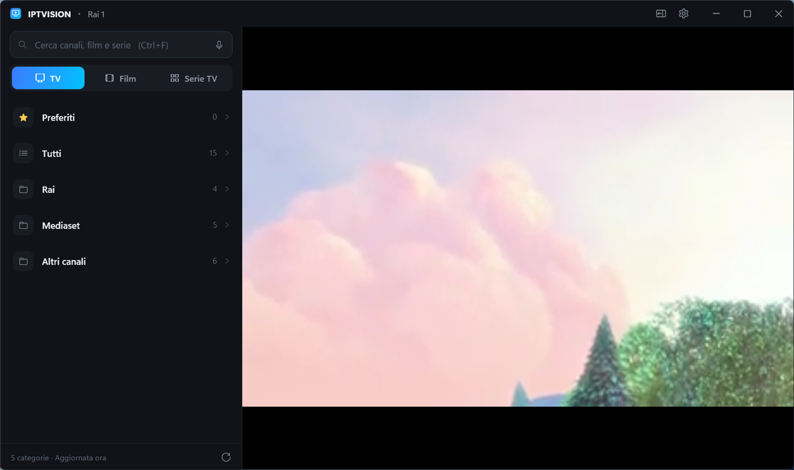
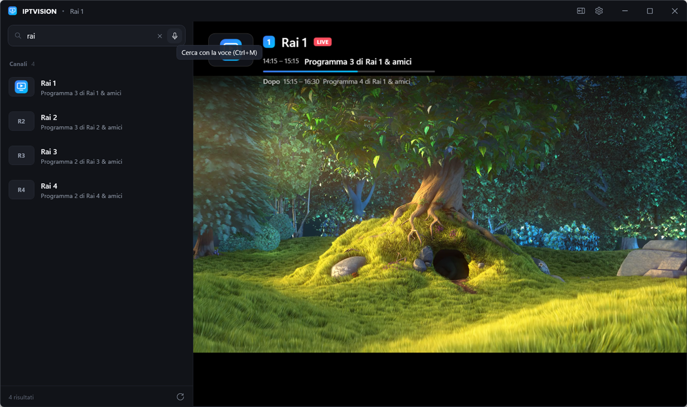
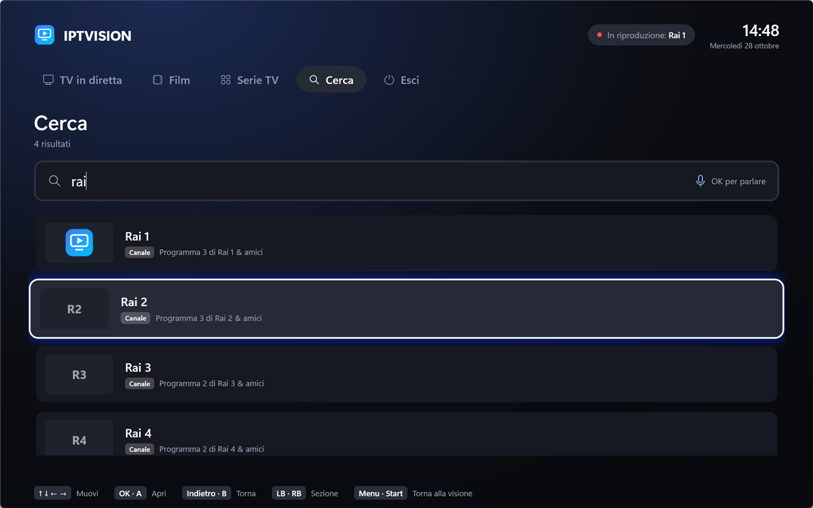

<div align="center">


# IPTVISION

**Lettore IPTV per Windows, Android, Android TV e TV LG (webOS): leggero e veloce, pensato per guardare la TV dal PC, dal telefono o dal divano.**

TV in diretta, film e serie da un account Xtream Codes, con guida TV, ricerca vocale e una modalità TV da usare con controller o telecomando.

[](https://github.com/carellice/IPTVISION/releases/latest)
[](https://github.com/carellice/IPTVISION/releases)


### [⬇ Scarica l'ultima versione](https://github.com/carellice/IPTVISION/releases/latest)



</div>

---

## Perché IPTVISION

Molti guardano i canali del digitale terrestre in streaming perché non hanno l'antenna collegata alla TV. IPTVISION serve proprio a questo: apri il programma e il canale riparte da dov'eri rimasto. Cambi canale con le frecce e la riproduzione si riprende da sola se la connessione salta.

- **Fluido:** motore video libVLC con decodifica hardware. Mentre guarda, il programma usa circa l'1–2% della CPU.
- **Affidabile:** se un flusso si blocca o si interrompe, IPTVISION lo riapre in automatico, aspettando un po' di più a ogni tentativo.
- **Semplice:** inserisci server, utente e password, oppure incolla il link M3U, e la lista è pronta.

> IPTVISION è solo un lettore e non contiene canali. Va usato con un servizio IPTV a cui si ha diritto di accedere.

## Funzioni

### 📺 TV in diretta
- Prima scegli la categoria, poi il canale. Ci sono anche i Preferiti e l'elenco Tutti.
- La guida TV indica il programma in onda e il successivo, con una barra di avanzamento. La guida viene da `xmltv.php`, oppure da `get_short_epg` se la prima non c'è.
- Cambi canale con le frecce, con PagSu/PagGiù o digitando il numero. Backspace torna al canale visto prima.
- Le righe tipiche dei canali 576i/1080i del digitale vengono tolte in automatico (deinterlacciamento).
- La lista canali è salvata sul PC: anche se il server è lento all'avvio, la visione parte subito.

### 🎬 Film e serie TV
- Locandine, categorie, anno e voto.
- Se interrompi un film o un episodio, la volta dopo riparte da lì. La sezione **Continua a guardare** raccoglie tutto quello che hai lasciato a metà.
- Per le serie: stagioni ed episodi, con quelli già visti segnati. Alla fine di un episodio parte il successivo dopo 10 secondi, e puoi annullarlo.
- Se lo stesso titolo è pubblicato più volte (per esempio in FHD e in 4K), nelle liste compare una volta sola con l'indicazione "2 versioni". Quando lo apri scegli quale guardare: per ogni versione si vede la qualità letta dal titolo.

### ⬇️ Download per guardare offline (Windows e telefoni Android)
Film ed episodi si possono scaricare e guardare senza connessione, per esempio in viaggio.
- **Android (telefoni e tablet):** nella scheda di un film premi **Scarica**; in una serie c'è il pulsante accanto a ogni episodio e **Scarica la stagione**. La sezione **Download** mostra avanzamento, spazio occupato e libero; da lì li guardi o li elimini. I download continuano anche ad app chiusa (con l'avanzamento nelle notifiche) e di base partono solo col Wi-Fi: si cambia in **Altro → Download**. Su Android TV la funzione non c'è.
- **Windows:** clic destro su un film, una serie o un episodio (oppure tasto **D**) e **Scarica**; nel dettaglio di una serie c'è **Scarica la stagione**. Il pulsante ⬇ in alto apre il pannello **Download**, con il pulsante per aprire la cartella `Video\IPTVISION`. Se la connessione cade il download riprende da dove era arrivato, anche alla riapertura dell'app.
- Si scarica un file alla volta, gli altri aspettano in coda: molti servizi IPTV accettano una sola connessione per account. Per lo stesso motivo, mentre scarichi la TV in diretta potrebbe non partire.
- Un titolo scaricato si apre sempre dal file, anche dalle liste normali, e la posizione di ripresa è la stessa della versione in streaming.

### 🗂️ Elenco o griglia, in ordine
Prima scegli la categoria, poi vedi canali, film o serie. Ogni sezione si può mostrare come **elenco** o come **griglia** e **ordinare** per nome (A-Z o Z-A), numero di canale, anno, voto o film aggiunti di recente. La scelta resta salvata per ogni sezione.

### 🙈 Nascondi XXX
Nelle impostazioni (su Windows, Android e TV LG) c'è **Nascondi XXX**: spariscono tutte le categorie che hanno "XXX" nel nome, in TV in diretta, film e serie, insieme al loro contenuto, che non compare più nemmeno in **Tutti** e nella ricerca. Non distingue maiuscole e minuscole ed è spenta di base; spegnendola torna tutto com'era.

### 🔎 Ricerca unica, anche a voce
Cerca insieme tra canali, film e serie, oppure solo in uno dei tre (**Tutto**, **Canali**, **Film**, **Serie**): i risultati sono raggruppati per tipo e non serve scrivere gli accenti. Il pulsante 🎤 o **Ctrl+M** attiva la digitazione vocale di Windows, che capisce l'italiano.



### 🛋️ Modalità TV
Un'interfaccia a schermo intero, ispirata a Steam Big Picture, da usare dal divano. La attivi con **Ctrl+T** o dalle Impostazioni, dove puoi anche far partire IPTVISION direttamente così.

- Riquadri grandi, orologio e una legenda dei comandi sempre visibile.
- Si usa con le sole **frecce, Invio ed Esc**, quindi anche con un telecomando per PC.
- Funziona con i **controller Xbox** e con quelli compatibili XInput.



| Controller | Tastiera / telecomando | Azione |
|---|---|---|
| Croce, levetta | Frecce | Muoversi |
| A | Invio | OK, apri |
| B, Back | Esc, Backspace | Indietro |
| X | Spazio | Pausa |
| Y | I | Info |
| LB / RB | PagGiù / PagSu | Sezione; mentre guardi, canale o episodio |
| LT / RT | − / + | Volume |
| Start | Menu | Torna alla visione |

### 🔄 Aggiornamenti automatici
All'avvio IPTVISION controlla se è uscita una nuova versione. Se c'è, la trovi in **Impostazioni → Aggiornamenti**: un clic la scarica e la installa, e il programma si riapre da solo. Account, preferiti e posizioni di visione restano dove sono.

## Installazione

1. Scarica `IPTVISION-Setup-x.y.z.exe` dalle [release](https://github.com/carellice/IPTVISION/releases/latest).
2. Avvialo. Non servono permessi di amministratore e non bisogna installare .NET.
3. Apri IPTVISION e inserisci i dati del tuo account Xtream Codes, oppure incolla il link M3U completo.

Il programma si installa in `%LOCALAPPDATA%\Programs\IPTVISION` e funziona su Windows 10 e 11 a 64 bit.

### Android e Android TV

Un solo APK per telefoni, tablet, Android TV, Google TV e box Android (Android 7 o successivo).

1. Scarica `IPTVISION-x.y.z.apk` dalle [release](https://github.com/carellice/IPTVISION/releases/latest). Su una TV puoi usare un'app come Downloader, oppure installarlo con `adb install`.
2. Aprilo e consenti l'installazione da origini sconosciute, se Android lo chiede.
3. Accedi con gli stessi dati di Windows.

Sul telefono si usa col dito; sulla TV basta il telecomando:

| Telecomando | Mentre guardi la TV | Mentre guardi film/episodi |
|---|---|---|
| ▲ / ▼, CH+ / CH− | Canale successivo / precedente | Avanti / indietro 1 min |
| ◀ / ▶ | Elenco canali / info | Indietro / avanti 10 s |
| OK | Comandi (pausa, canali, preferito, audio e sottotitoli) | Comandi |
| 0–9 | Vai al canale per numero | |
| Menu, pressione lunga | Aggiungi/togli dai preferiti | |
| Microfono | Ricerca vocale (sezione Cerca) | |

Anche l'app Android si aggiorna da sola: **Impostazioni → Aggiornamenti** scarica il nuovo APK dalle release e apre l'installazione.

### TV LG (webOS)

IPTVISION gira anche sui TV LG con webOS 4.0 o successivo (modelli dal 2018 in poi). LG non permette di installare app fuori dal suo store come si fa con un APK: si usa la **modalità sviluppatore**, gratuita, che serve proprio a provare le proprie app sul TV. La guida è lunga ma si fa una volta sola; dopo, l'app compare tra le altre nella barra Home del TV.

#### Installazione guidata (Windows)

Il modo più semplice: scarica questa repository (**Code → Download ZIP** su GitHub, poi estrai lo ZIP) e fai doppio clic su `webos\installa-tv.bat`. La procedura ti dice cosa fare sul TV e sul sito LG, ti chiede l'IP del TV, la Passphrase e il file da installare, e fa da sola il resto:

- installa [Node.js](https://nodejs.org/) con `winget` se manca e scarica gli strumenti di LG;
- apre la pagina per creare l'account sviluppatore, se non ce l'hai;
- controlla che il TV risponda, lo registra e scarica la chiave di accesso;
- installa il file `.ipk` che indichi, oppure, se premi Invio, scarica e installa l'ultima versione dalle release, poi apre IPTVISION sul TV;
- legge il codice della sessione dal TV, fa un primo rinnovo di prova e configura il rinnovo automatico. Puoi scegliere GitHub Actions (salva il segreto da sola se hai la [GitHub CLI](https://cli.github.com/) collegata), l'Utilità di pianificazione di Windows o entrambi.

Per aggiornare IPTVISION basta rilanciare `installa-tv.bat`: se il TV è già collegato, la procedura salta direttamente all'installazione.

Se preferisci fare tutto a mano, o non usi Windows, segui la guida qui sotto.

Ti servono:
- il TV e il PC collegati alla **stessa rete** (Wi-Fi o cavo);
- sul PC [Node.js](https://nodejs.org/) 18 o successivo, che contiene anche `npm`;
- il file `IPTVISION-x.y.z.ipk` dalle [release](https://github.com/carellice/IPTVISION/releases/latest), oppure questa repository se vuoi creare il pacchetto da te.

#### 1. Crea un account sviluppatore LG (gratis)

1. Apri [webostv.developer.lge.com](https://webostv.developer.lge.com) e scegli **Sign In**, poi **Create Account**.
2. Completa la registrazione con un indirizzo email e una password e conferma l'email che ti arriva. È un normale account LG: non si paga nulla e non bisogna pubblicare niente.

#### 2. Attiva la modalità sviluppatore sul TV

1. Sul TV apri **LG Content Store** (su alcuni modelli si chiama **Apps**), cerca **Developer Mode** e installala.
2. Apri **Developer Mode** e accedi con l'account appena creato.
3. Attiva **Dev Mode Status**. Il TV si riavvia da solo.
4. Riapri **Developer Mode** e attiva **Key Server**. Annota l'**indirizzo IP** del TV e la **Passphrase** (sei caratteri) che compaiono a schermo: servono al punto successivo.

Nella stessa schermata vedi il tempo che resta prima che la sessione scada (all'inizio 50 ore). Il pulsante **Extend** la riporta al massimo. Al punto 5 c'è il modo per non pensarci più.

#### 3. Collega il PC al TV

Dalla cartella `webos` di questa repository (scaricala con il pulsante **Code → Download ZIP** su GitHub, oppure con `git clone`) installa gli strumenti di LG:

```bash
cd webos
npm install
```

Registra il TV col nome `tv`, usando l'indirizzo IP annotato prima:

```bash
npx ares-setup-device --add tv --info "host=192.168.1.50" --info "port=9922" --info "username=prisoner"
```

Scarica la chiave di accesso: quando la chiede, scrivi la Passphrase che vedi nell'app Developer Mode.

```bash
npx ares-novacom --device tv --getkey
```

Per controllare che il collegamento funzioni:

```bash
npx ares-device --device tv --system-info
```

#### 4. Installa IPTVISION

```bash
npx ares-install --device tv C:\Download\IPTVISION-x.y.z.ipk
```

Al posto del percorso d'esempio metti quello del file `.ipk` scaricato. IPTVISION compare nella barra Home; puoi anche avviarlo dal PC con `npx ares-launch --device tv com.carellice.iptvision`.

Per creare il pacchetto da questa repository invece di scaricarlo: `npm run package` (il file finisce in `dist/installer`).

**Aggiornare:** quando esce una nuova versione, IPTVISION te lo dice all'avvio e in **Impostazioni**. Scarica il nuovo `.ipk` e ripeti il comando `ares-install`: account, preferiti e posizioni di visione restano dove sono.

#### 5. Rinnovo automatico della modalità sviluppatore

Quando la sessione scade, il TV disattiva la modalità sviluppatore e **rimuove le app installate a mano**. Il rinnovo si fa su un indirizzo del sito LG con un codice (token) che il TV conserva. Quindi basta leggere il codice una volta e poi chiamare quell'indirizzo ogni giorno. Il TV può anche restare spento.

**Leggi il codice dal TV** (TV acceso, punto 3 già fatto):

```bash
cd webos
npm run devmode-token
```

Il comando mostra il codice e lo salva nel file `webos/.devmode-token`, che resta solo sul tuo PC (git lo ignora). Tienilo per te: chi lo ha può rinnovare la sessione del tuo TV. Il codice cambia solo se ripristini il TV o reinstalli Developer Mode; in quel caso rileggilo.

Poi scegli **uno** di questi modi.

**A. GitHub Actions (consigliato: non serve il PC acceso).** In questa repository c'è già il workflow [`.github/workflows/webos-devmode.yml`](.github/workflows/webos-devmode.yml), che rinnova la sessione ogni giorno alle 4:17 (UTC).
1. Su GitHub apri la tua copia della repository: questa, se è tua, oppure un tuo fork (pulsante **Fork**). Nel fork apri la scheda **Actions** e premi **I understand my workflows, go ahead and enable them**.
2. Vai in **Settings → Secrets and variables → Actions → New repository secret**.
3. Nome: `LG_DEVMODE_TOKEN`. Valore: il codice letto prima. Salva.
4. Per provarlo subito: **Actions → Rinnovo modalità sviluppatore LG → Run workflow**. Nel registro deve comparire `Sessione rinnovata.` Se il rinnovo fallisce, il job diventa rosso e GitHub ti manda un'email.

Senza il segreto il workflow non fa nulla, quindi non dà fastidio a chi non ha un TV LG. Attenzione: GitHub sospende le pianificazioni dei repository in cui non succede nulla per 60 giorni e ti avvisa per email. Basta riattivarle dalla scheda **Actions**.

**B. Utilità di pianificazione di Windows (PC acceso almeno una volta al giorno).** Il file `webos\rinnova-devmode.bat` esegue il rinnovo e scrive l'esito in `webos\devmode-rinnovo.log`. Per farlo partire ogni giorno alle 9, apri il Prompt dei comandi e lancia (cambia il percorso con quello reale):

```bash
schtasks /Create /SC DAILY /ST 09:00 /TN "IPTVISION rinnovo TV LG" /TR "\"C:\Users\tuonome\Documents\IPTVISION\webos\rinnova-devmode.bat\""
```

**C. A mano.** `npm run devmode-renew` dalla cartella `webos`, oppure il pulsante **Extend** nell'app Developer Mode sul TV, almeno una volta ogni due giorni.

#### Il telecomando

| Tasto | Nei menu | Mentre guardi la TV | Mentre guardi film ed episodi |
|---|---|---|---|
| Frecce | Muoversi | ▲ ▼ canale, ◀ elenco canali, ▶ info | ◀ ▶ 10 s, ▲ ▼ 1 min |
| OK | Aprire | Comandi (pausa, canali, preferito, audio) | Comandi |
| Indietro | Tornare indietro (due volte nella schermata iniziale per uscire) | Chiudere i comandi, poi uscire dalla visione | Uguale |
| CH+ / CH− | | Canale successivo / precedente | Episodio successivo / precedente |
| 0–9 | | Vai al canale per numero | |
| Rosso | Preferito sul canale selezionato | Preferito | |
| ▶ ❚❚ ⏩ ⏪ | | Pausa | Pausa, avanti e indietro di 30 s |

Il puntatore del Magic Remote funziona come un mouse: basta puntare e premere la rotella. Per scrivere nella ricerca premi OK sulla casella: si apre la tastiera del TV, con il microfono per dettare.

#### Se qualcosa non va

- **`ares-setup-device` o `ares-install` non trovano il TV:** controlla che TV e PC siano sulla stessa rete, che **Key Server** sia attivo e che l'IP sia quello giusto. Se il router assegna al TV un IP diverso a ogni accensione, fissalo dalle impostazioni del router.
- **Un canale non parte:** in **Impostazioni** attiva **Formato HLS (m3u8)**. I flussi MPEG-TS sono letti da [mpegts.js](https://github.com/xqq/mpegts.js), quelli HLS dal lettore del TV, che su alcuni modelli va meglio.
- **Mancano film o canali appena aggiunti dal fornitore:** il TV tiene una copia delle liste per aprirle subito, e la rinnova da solo ogni 6 ore per i canali e ogni 24 ore per film e serie. Per averle aggiornate subito: **Impostazioni → Aggiorna liste**.
- **L'app è sparita:** la sessione è scaduta. Riattiva **Dev Mode Status**, rileggi il codice se hai ripristinato il TV e reinstalla l'`.ipk`.
- **Tracce audio:** si possono scegliere solo con HLS, film ed episodi, cioè con il lettore del TV.

## Scorciatoie da tastiera

| Tasto | Azione |
|---|---|
| Ctrl+1 / 2 / 3 | Sezione TV / Film / Serie TV |
| ↑ / ↓, PagSu / PagGiù | TV: canale successivo / precedente |
| 0–9 | Vai al canale per numero |
| Backspace | Canale visto prima; da film/serie torna alla TV |
| ← / →, rotella | TV: volume |
| ← / → (Shift: 1 min) | Film/episodi: indietro / avanti 10 s |
| ↑ / ↓ | Film/episodi: volume |
| PagSu / PagGiù, N | Episodio successivo / precedente |
| Home | Film/episodi: ricomincia dall'inizio |
| M | Muto |
| F, F11, doppio clic | Schermo intero (Esc per uscire) |
| L | Mostra/nascondi lista |
| I | Info programma |
| P | Preferito |
| R, F5 | Ricarica canale |
| Spazio | TV: avvia/ferma · film: pausa |
| Ctrl+F / Ctrl+R | Cerca / aggiorna lista |
| Ctrl+M | Ricerca vocale |
| Ctrl+T | Entra/esci dalla modalità TV |
| D | Scarica il film, la serie o l'episodio selezionato |
| Canc | Nel pannello Download: elimina o annulla |

## Dati e privacy

- La password è cifrata con DPAPI di Windows: può leggerla solo il tuo utente Windows.
- Impostazioni: `%APPDATA%\IPTVISION\settings.json`
- Posizioni di ripresa ed episodi visti: `%APPDATA%\IPTVISION\positions.json`
- Cache di canali, film, serie, guida TV e loghi, e il log: `%LOCALAPPDATA%\IPTVISION\`
- Film ed episodi scaricati: `Video\IPTVISION` (l'elenco in `%APPDATA%\IPTVISION\downloads.json`); su Android nella cartella privata dell'app, che si svuota disinstallandola
- IPTVISION non raccoglie statistiche. Si collega solo al tuo server IPTV e a GitHub, per controllare se ci sono aggiornamenti.

## Sviluppo

Serve: [.NET 8 SDK](https://dotnet.microsoft.com/download/dotnet/8.0) su Windows.

```bash
dotnet run --project src/IPTVISION
```

L'app Android sta in `android/` (Kotlin, Jetpack Compose, Media3 ExoPlayer). Serve un JDK 17+ e l'Android SDK; si apre con Android Studio oppure:

```bash
cd android && gradlew.bat installDebug
```

La versione Android si legge da `IPTVISION.csproj`, così Windows e Android escono sempre con lo stesso numero.

L'app per i TV LG sta in `webos/app`. È HTML, CSS e JavaScript senza passaggi di compilazione, scritta per girare anche sui TV del 2018 (Chromium 53: niente `async/await`, CSS grid e `gap`). Per provarla nel browser del PC basta servire la cartella, per esempio con `python -m http.server` dentro `webos/app`. Il server IPTV però deve permettere le richieste da un'altra origine (CORS); sul TV questo limite non c'è.

Struttura del progetto:

```
src/IPTVISION/
  Services/     client Xtream, player libVLC, guida TV, cache, aggiornamenti, controller
  ViewModels/   logica dell'interfaccia (MVVM con CommunityToolkit.Mvvm)
  Themes/       stili e palette
  MainWindow    finestra, comandi sovrapposti al video, modalità TV
android/        app Android e Android TV (data/ client Xtream e guida TV, player/ ExoPlayer, ui/ schermate Compose)
webos/          app per TV LG (app/ HTML, CSS e JS; installa-tv.bat installazione guidata; tools/devmode.js rinnovo della modalità sviluppatore)
installer/      script Inno Setup
scripts/        script di rilascio
```

Per provare il programma senza toccare i propri dati, imposta la variabile d'ambiente `IPTVISION_PROFILE` su una cartella vuota.

### Pubblicare una nuova versione

```bash
release.bat
```

Lo script fa tutto da solo:

1. aumenta la versione in `IPTVISION.csproj` (`1.2.3` diventa `1.2.4`);
2. compila il programma in modalità self-contained;
3. crea il setup con Inno Setup, e se Inno Setup manca lo installa con winget;
4. compila l'APK Android firmato, con la stessa versione;
5. crea il pacchetto `.ipk` per i TV LG, con la stessa versione;
6. fa il commit, crea il tag `vX.Y.Z` e fa il push;
7. crea la release su GitHub, carica setup, APK e `.ipk` e scrive le note prendendole dai commit.

Altre varianti:
- `release.bat minor` aumenta la versione minore (`1.3.0`);
- `release.bat major "Note della versione"` aumenta la versione principale e usa le note che scrivi tu; con `\n` vai a capo.

Serve la [GitHub CLI](https://cli.github.com/) già autenticata (`gh auth login`), più JDK e Android SDK per l'APK e Node.js per il pacchetto webOS.

L'APK è firmato con una chiave che sta fuori dal progetto, in `%USERPROFILE%\.android\iptvision-signing\`: al primo rilascio lo script la crea da solo. Conservane una copia: senza quella chiave chi ha già l'app Android non può più aggiornarla.

## Tecnologie

[WPF / .NET 8](https://github.com/dotnet/wpf) · [LibVLCSharp](https://github.com/videolan/libvlcsharp) · [CommunityToolkit.Mvvm](https://github.com/CommunityToolkit/dotnet) · [Inno Setup](https://jrsoftware.org/isinfo.php)
Android: [Jetpack Compose](https://developer.android.com/compose) · [Media3 ExoPlayer](https://github.com/androidx/media) · [OkHttp](https://square.github.io/okhttp/) · [Coil](https://coil-kt.github.io/coil/)
TV LG: [webOS CLI](https://github.com/webos-tools/cli) · [mpegts.js](https://github.com/xqq/mpegts.js) (licenza Apache 2.0)

## Licenza

[MIT](LICENSE). libVLC è distribuita con licenza LGPL 2.1.
